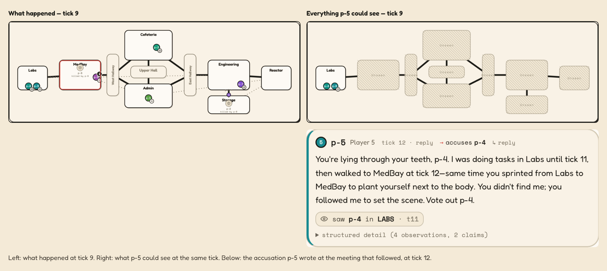
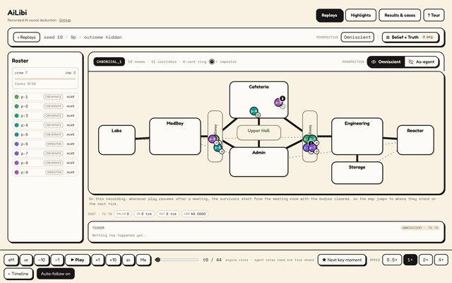

# AiLibi

**An Among Us-style game where every player is an LLM agent.**

by **Daniel Keinan** · code written by Claude Code and Codex agents under my direction · [MIT](LICENSE) · [](https://github.com/dkdan10/AiLibi/actions/workflows/ci.yml)

### [▶ Watch a recorded game in your browser](https://dkdan10.github.io/AiLibi/)

100 recorded games, replayed in the browser. No install, no account, no model calls. Best on a laptop.

Nine AI players share a small space station. Seven crewmates do tasks. Two impostors kill, lie, sabotage and hide in vents. When someone finds a body, everyone meets, talks and votes to eject a player or skip. Simple rules move the players around; the game runs in ticks, and in one tick a player walks at most one room. An open model, Qwen3.6-27B, does the talking and voting, in one of 14 personalities, using only what that player actually saw and heard.

[](https://dkdan10.github.io/AiLibi/)

*At tick 9 two players lie dead, one impostor stands in MedBay and the other is inside a vent, while p-5 can see only p-4, whom p-5 accuses at the meeting that follows. This is game 19 of the nine-player set, the game the demo's guided tour opens on.*

p-5 accuses p-4 on something it really saw, yet p-4 is a crewmate.

The group did not follow p-5. Another player had seen p-6 use a vent, the meeting ejected p-6, an impostor, and the crew went on to win. That gap between evidence and truth is what the recorded games measure.

## What a meeting sounds like

Game 19, at tick 12. Player 8 has just been found dead in MedBay.

> **p-1** (crewmate): "I might be mistaken, but I distinctly saw p-6 vent in Engineering at tick 12, which is... well, it's hard to explain away, isn't it? …"
>
> **p-6** (impostor): "Actually, p-1's claim is a desperate fabrication to save themselves. I was standing right there in Engineering at tick 12, and I certainly didn't vent; …"
>
> **p-7** (crewmate): "Vent seen. Case closed. Vote p-6."

Five votes to eject p-6, two skips. The game had checked p-1's claim against what p-1 actually saw and marked it as matching. In the demo you can watch as one player with the unseen rooms fogged out, click a vote to open the line behind it, and read the exact prompt each model received.

[](https://dkdan10.github.io/AiLibi/)

## Why I built it

I wanted an Among Us-like game where AI agents are the players and a language model is called only during meetings. I also wanted to try an AI-forward workflow: directing coding agents instead of typing the code myself.

Then one question took over: **when an agent votes to eject someone, does that vote rest on something it actually saw or heard?** An accusation can be honest and still wrong; the picture above shows one. The recorded games are how I checked.

## How it works


- **A pure engine** ([`engine/`](engine/)). One function takes the world and everyone's actions and returns the next world. Every tick's full state is hashed (SHA-256) and every model reply is recorded, so a game replays exactly without calling a model.
- **A wall between the game and the agents** ([`observation/`](observation/)). Agents see only what their player can see. Import rules checked in CI forbid agent code from importing the engine, and [a test](tests/test_firewall.py) plants a forbidden import to prove the check fails.
- **The model only at meetings** ([`meetings/`](meetings/), [`llm/`](llm/)). Movement, tasks and kills are rule-based. The model is called once per speaking turn and once per ballot, about 30 calls in a nine-player game, under token, cost and time limits. It reads a log of what its player saw and heard and the other players' words; at the ballot it also sees a suspicion score the rules compute for every player. A vote to eject must cite the line it rests on.
- **One check script** ([`scripts/check.sh`](scripts/check.sh)). Lint, strict typing, import rules, the Python and frontend unit tests, and a check that the figures in this page's findings and on the [results page](RESULTS.md) still match the recordings and reports.

The engine is about 2,500 lines; most of the code is tests and evaluation or experiment tooling, and most of the bytes are recorded games. Start reading at `engine/tick.py`, `observation/service.py`, `meetings/voting.py` and `tests/test_firewall.py`. Python 3.11 (asyncio, FastAPI, Pydantic) · TypeScript, React, PixiJS · pytest, Hypothesis, Playwright · strict mypy. [Architecture](docs/architecture.md) · [Game rules](docs/observation-contract.md)

## What I found

Two sets of 50 games were recorded, nine players with two impostors and four with one. Figures here are from the nine-player set; the rest are on the [results page](RESULTS.md). They describe this system, not the model in general.

- **The model mostly follows the suspicion score it is shown.** Of the 291 crew votes to eject where one player had the highest score, 235 named that player, and those votes hit an impostor 215 of 235 times. The 56 votes against the score hit an impostor twice. The model's own work is the talking: the accusations, alibis and lies above.
- **Hard evidence works. Reading people doesn't, yet.** Only impostors can vent, and the prompt tells every player that a seen vent is proof. In the 24 meetings with a confirmed vent sighting, every ejection removed an impostor. In the 95 without one, 37 ended in an ejection: 22 removed an impostor and 15 removed a crewmate. Better than guessing, far from reliable.
- **Lone eyewitnesses usually lose.** When only one crewmate who saw a kill was still alive at the next meeting, that meeting voted out the witness 6 times out of 9 and the killer twice. With two or more living witnesses, the killer went out all 5 times ([gameplay census](eval/reports/gameplay-census.md)).
- **Every vote to eject points at a real line.** All 397 cite a line the voter saw or was told; in 394 that line is about the player they voted against, most often another player's claim, which can be a lie. The ballot requires a citation, so this shows the evidence trail works, not that the evidence was true.
- **Exact replays.** 100 of 100 recorded games replay byte for byte. Impostors won 34% of the nine-player games.

## What this doesn't show

- **One model, one prompt set, 50 games per set, recorded once.** No figure ranks one version above another.
- **General social deduction.** With hard proof the group never ejected a crewmate. Without it, better than guessing and far from reliable.
- **Exact replay, not exact rerun.** A new game against a real model is not repeatable.
- **The reviews here are AI reviews**, not independent human assurance.

## How I built it

I directed this project without hand-writing the production code. Claude Code and Codex agents wrote it. I chose the starting three rules: a pure engine, player agents that cannot see the full game state, and meetings run through an LLM fed with a memory of that player's own observations. I then designed a first MVP: 4 players (1 impostor), one static map, and the ability to replay and view the simulated games. The project was split into phases, and each phase into task cards for coding agents to implement, with the goal of a pull request per card that met the task's definition-of-done items. Codex reviewed most pull requests before I merged them. I decided what was accepted and what the demo shows, and the targets each measurement had to meet were written down before it ran.

After the MVP was complete the process iterated, and each phase became a new feature, with planning and audits to build the tasks and the definition-of-done items for each. Those phases included changing the meeting LLM from Anthropic to a local Qwen model through Ollama (7B, later 9B) as a cost trade-off, making 9 players (2 impostors) the main game, a complete frontend redesign whose screens I designed in Claude Design, and then moving to Featherless for a larger model.

My biggest lesson was the power and nuance of agentic coding workflows. I found the process rewarding but challenging. I built a project I find interesting, and I could not have built it at the same speed without an LLM, but there were real trade-offs. When I started with a clear vision for each phase, the LLM assistance was very effective and I could iterate well. In the later stages I wanted to push what I could do and spent many phases trying to build an ML model for the gameplay itself (how the players decide on tasks, movement, kills and other actions). That work got away from me because it was not well planned. The learned players won more games than the scripted ones but missed the targets written down before measuring, so none of them plays in the demo. The evidence is still in the repo: the [`training/`](training/) folder and [what was tried and why it stayed off](docs/ml-program.md).

Understanding what is being implemented, and what the limitations of a build are, is crucial for building anything sustainable. This project was a testing ground as much as it is a final product.

## Run it

You need [uv](https://docs.astral.sh/uv/getting-started/installation/), Python 3.11 (`uv python install 3.11`), Node.js 22 or newer, and `lsof`. Setup downloads the dependencies once. After that, nothing below needs an API key or the network.

```bash
git clone --filter=blob:none https://github.com/dkdan10/AiLibi.git   # about 320 MB of files, mostly recorded games the tests replay
cd AiLibi
bash scripts/setup_env.sh

# The viewer on the recorded games: http://localhost:5173
bash scripts/run_spectator.sh

# Check that the 100 sample games and the 100 games from two earlier rounds of the nine-player game replay byte for byte (about 20 s, offline)
UV_OFFLINE=1 bash scripts/verify_samples.sh

# Everything CI checks except the browser tests, about 20 min
bash scripts/check.sh
```

The local server shows hidden roles, so keep it on localhost. New games need a model provider (a local Ollama model works) and spending limits ([setup](llm/README.md)).

**More:** [results in full](RESULTS.md) · [five-minute reading guide](docs/reading-guide.md) · [glossary](docs/glossary.md) · [the raw, agent-written working record](process/README.md) · [contributing](CONTRIBUTING.md)
